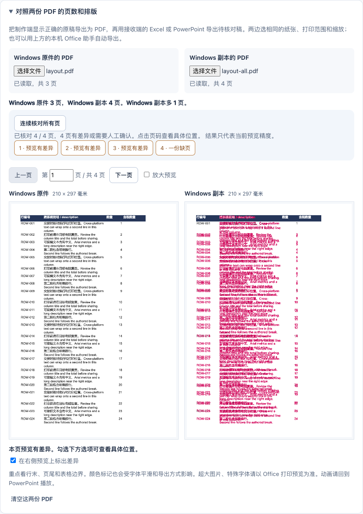

# OfficeBridge

**Keep PowerPoint and Excel files editable when sharing between Mac and Windows.** Inspect font and compatibility risks, make an optional font-repair copy, then check the result using the receiving computer's own desktop Office. Documents stay on your computer.

[中文](README.md) · [Test evidence and limitations](docs/TESTING.md) · [MIT license](LICENSE)

## Get started

- [Windows portable bundle](https://github.com/blqs886-lang/officebridge/releases/download/v1.1.0/OfficeBridge-v1.1.0-Windows.zip)
- [Mac portable bundle](https://github.com/blqs886-lang/officebridge/releases/download/v1.1.0/OfficeBridge-v1.1.0-Mac.zip)
- [Single offline HTML](https://github.com/blqs886-lang/officebridge/releases/latest/download/OfficeBridge.html) for inspection, repair and manual PDF comparison
- [All downloads, source and checksums](https://github.com/blqs886-lang/officebridge/releases/latest)

Extract the complete ZIP, then open `OfficeBridge.html` in Chrome or Edge. No account, Node.js or Python is required. The interface is currently in Chinese; this guide gives the main labels.


1. Under **文件要在哪里打开？**, choose the receiving platform: Windows or Mac.
2. Add a `.pptx` or `.xlsx` file. **表格样例** loads a synthetic spreadsheet if you want to try it first.
3. If the original already works on the receiving computer, keep it. To try a repair, **只选较少影响排版的位置** selects eligible lower-impact font changes. Review the selection, then choose **生成并下载副本**. The editable copy has a `.windows` or `.mac` suffix.
4. On the receiving computer, double-click `OfficeBridge-Windows.cmd` or `OfficeBridge-Mac.command`. Choose the original, optionally the repaired copy and a PDF exported on the source computer. Start the check; a local result page opens automatically.

The native helper requires installed, activated **desktop Excel or PowerPoint**. Browser inspection does not. On first use, macOS may ask permission for Terminal to control Office and for Office to access the chosen folder. The unsigned Mac launcher may need to be opened via Finder's contextual Open action or the specific blocked-item entry in Privacy & Security; do not disable system-wide security.



## What it does

- Inspects standard unencrypted PPTX and XLSX packages, font declarations, selected formula/encoding/resource risks and layout-sensitive areas.
- Makes only explicitly selected font-name substitutions. Text, formulas, media, dimensions and unknown package parts remain editable and are preserved. Unchanged parts are checked byte for byte.
- Offers separate Windows and Mac target profiles, with optional recipient font lists and custom mappings.
- Uses local desktop Office to export real PDF previews. The Windows helper also records Excel page-break positions and selected PowerPoint text metrics.
- Compares PDF page counts, paper dimensions and corresponding page previews locally, with an optional visual difference overlay.

It does **not** promise identical output in every Office version. Font substitutions can improve or worsen wrapping and pagination. PDF comparisons cover static appearance, not animations, media playback or formula correctness. Compare against a PDF exported on the source computer, then edit/reopen and play the features you need in the receiving Office.

Keynote and Numbers documents must first be exported as PPTX or XLSX. DOCX, CSV, legacy formats, encrypted files, macros and signed-file repair are outside the current scope. No proprietary fonts are bundled. The app does not recover lost text, automatically reflow layouts or rewrite formulas.

## Privacy and development

All document processing is local. There is no document upload service or analytics in the app. Reports can contain document names, content excerpts, links and full PDF previews; keep them private unless you have reviewed what they contain. The native helper is not a sandbox for untrusted Office files. See [SECURITY.md](SECURITY.md).

For development use Node.js 22.13 or later:

```sh
npm ci
npm test
npm run build
npm run build:portable
```

Release packaging (`npm run release:local` / `npm run release:verify`) requires a Git checkout with new source files staged. Building the application from the source ZIP does not.

Command-line examples:

```sh
node scripts/cli.mjs check slides.pptx --target windows --out reports
node scripts/cli.mjs check workbook.xlsx --target mac --out reports
```

[Architecture](docs/ARCHITECTURE.md) · [Contributing](CONTRIBUTING.md) · [Third-party notices](THIRD_PARTY_NOTICES.md)
