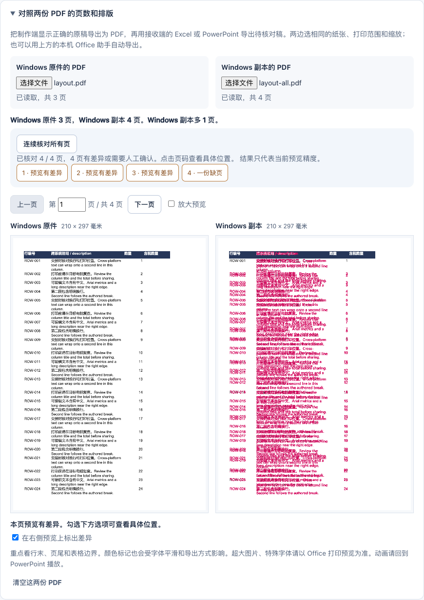

# OfficeBridge

**让可编辑的 PowerPoint 和 Excel 文件在 Mac 与 Windows 之间更稳妥地交接。** 检查字体风险、按需生成修复副本，再用接收电脑上的桌面 Office 自动导出预览，核对换行和打印分页。文件在本机处理，原件保留。

[English](README.en.md) · [使用指南](docs/QUICKSTART.md) · [真实测试与限制](docs/TESTING.md)

## 下载与使用

| 你要做什么 | 下载 |
| --- | --- |
| 在 Windows 检查，并用本机 Office 核对 | [Windows 便携包](https://github.com/blqs886-lang/officebridge/releases/download/v1.1.0/OfficeBridge-v1.1.0-Windows.zip) |
| 在 Mac 检查，并用本机 Office 核对 | [Mac 便携包](https://github.com/blqs886-lang/officebridge/releases/download/v1.1.0/OfficeBridge-v1.1.0-Mac.zip) |
| 只做字体检查、修复和手动 PDF 对照 | [单个 HTML 文件](https://github.com/blqs886-lang/officebridge/releases/latest/download/OfficeBridge.html) |
| 源码、完整包和校验值 | [所有发布文件](https://github.com/blqs886-lang/officebridge/releases/latest) |

不需要注册账号或安装开发工具。完整解压后，用 Chrome 或 Edge 打开 `OfficeBridge.html`。


1. 选择 **“文件要在哪里打开？”**：Windows 或 Mac。拖入 `.pptx` / `.xlsx`；也可以先点“表格样例”。
2. 看检查结果。原件在接收电脑上已显示、打印正常，就继续用原件。需要换字体时，先点 **“只选较少影响排版的位置”**，确认后点 **“生成并下载副本”**。受限位置可以逐处选择。
3. 下载的副本带 `.windows` 或 `.mac`，仍可用 PowerPoint 或 Excel 编辑。
4. 在接收电脑的解压文件夹双击 **`OfficeBridge-Windows.cmd`** 或 **`OfficeBridge-Mac.command`**。选原件，可选修复副本、制作端导出的参照 PDF，开始核对。完成后会自动打开结果页。

**本机 Office 核对需要已安装并激活的桌面 PowerPoint / Excel。** 网页检查本身不需要 Office。首次 Mac 核对可能要求允许终端控制 Office、允许 Office 访问选定文件夹；按系统窗口确认即可。[核对助手的完整步骤](docs/NATIVE-OFFICE-CHECK.md)



图中是合成长表：全部换字体后从 3 页变成 4 页。这个结果应当被发现并撤回；自动修复并不意味着选择越多越好。

Mac → Windows、Windows → Mac 使用相同流程。另一台电脑的原始 PDF 是外观参照；只对比接收端的原件与修复稿，只能说明它们在这台电脑上的差异。PDF 能核对静态排版；动画、音视频及重要公式仍需在 Office 内实际操作。

Keynote 或 Numbers 请先导出为 PowerPoint / Excel。字体替换可能改变字宽和换行；工具不会安装或嵌入字体，不猜测丢失的文字。疑似编码错读会提供短预览供人工核对。

## 支持范围

| 内容 | 检查 | 自动修改范围 |
| --- | --- | --- |
| PPTX 字体 | 文字、主题、母版、版式、图表及项目符号的字体声明 | 仅主动选择的字体名称替换 |
| PPTX 其他内容 | 按文稿页序定位问题，检查外部资源、媒体、嵌入对象、动画及专用图标字符 | 不改写；不把幻灯片或对象转成图片 |
| PPTX 文本边界 | 有限坐标和显式字号的启发式提示 | 不移动文本框，不自动调整字号 |
| XLSX 字体 | 单元格样式、富文本及 DrawingML 字体 | 仅主动选择的字体名称替换 |
| XLSX 数据与功能 | 嵌套函数、公式中的文件链接、缺失或报错的已存结果、编辑保护、日期系统、长数值与前导零等风险 | 不改公式、数值、日期、链接或打印设置 |
| 已签名或含宏内容 | 安全可读取时提供有限检查 | 禁止修复 |
| Strict OOXML | 有限只读检查 | 禁止修复 |
| 本机 Office 核对助手 | 在接收端打开所选文件并导出 PDF；Windows 另记录 Excel 换页点与 PowerPoint 文字布局信息 | 打开独立工作副本，核对原输入指纹 |
| 两份本机 PDF | 总页数、纸张大小、逐页预览和图像差异 | 仅作排版对照 |
| Keynote、Numbers、Pages、DOCX、CSV、旧版 Office 文件 | 当前不支持 | 不处理 |
| 加密、损坏或超过处理上限的文件 | 拒绝处理或报告结构问题 | 不尝试恢复 |

未知的包内内容会被保留。修复会记录修改部件、原字体、目标字体和次数，并逐字节核对未修改部件。重新打包会改变 ZIP 容器；修复副本不是与原件字节完全相同的文件。

### 怎样理解验证状态

- 在一份 72 行的合成长表上，Windows Excel 打开原件为 3 页，全部换字体为 4 页，使用快捷选择为 3 页。该稿 Mac 原件为 5 页。真实 Numbers 导出样本在三种 Windows 选择下均为 1 页。
- 在 Mac 另存的金额演示稿上，Windows 原件四行金额的横向偏差约 222 磅。为这些固定文本框单独选用 Consolas 后，Windows 桌面 PowerPoint 的金额坐标对齐，原用 Arial 的对照页保持原样。
- 用离线浏览器回归覆盖第一次选文件、只改同页中的普通文本、生成可编辑副本、真实 PDF 的页数及图像对照等操作。另在真实桌面 Office 中验证选定样本的编辑、打印与动画。具体环境和范围见 [测试记录](docs/TESTING.md)。
- Windows 与 Mac 便携包提供本机核对助手。输出可直接打开的结果 HTML、PDF 和核对记录。记录对应本次软件环境与文件指纹，不代表其他电脑必然相同。[本机 Office 核对](docs/NATIVE-OFFICE-CHECK.md)

## 处理上限与隐私

浏览器每批最多 20 个文件、合计 250 MiB。单文件上限 100 MiB；包内最多 5,000 个条目，解压总量 200 MiB，单个条目 100 MiB，单个 XML 12 MiB、XML 总量 40 MiB。大于 1 MiB 的条目超过 300 倍压缩比时拒绝处理；流式解压发现实际内容超过声明，或连续超过 128 KiB 输入没有输出时，也会停止。

浏览器每次检查或修复设有 60 秒超时：超时后停止本次 Worker 并重新初始化，后续文件可继续检查。该计时依赖浏览器调度，不是精确 CPU 限额；CLI 没有自动超时。复杂或恶意文件仍可能消耗较多资源，OfficeBridge **不是杀毒器或不可信文档沙盒**。

应用不上传文稿。导出的报告可能含文件名、内部路径、外部链接、疑似乱码片段及预览、公式片段和其他检查证据；不要未经检查就公开报告或真实文档。更多说明见 [SECURITY.md](SECURITY.md)。

## 开发与构建

需要 Node.js **22.13 或更新版本**。在源码目录执行：

```sh
npm ci
npm test
npm run build
npm run build:portable
```

`npm ci` 安装开发依赖时可能访问 npm；生成的应用处理文档时不联网。`npm run dev` 启动本地开发页面。修改源码后先执行 `npm run build`，再用 `npm run build:portable` 将该次构建生成的文件打包为 `release/OfficeBridge.html`。

```sh
npm run release:local
npm run release:verify
```

发布打包需要 Git 检出目录，并将新增源文件暂存；从源码 ZIP 构建应用本身不需要 Git。命令在 `release/` 整理单 HTML、Windows / Mac 便携 ZIP、完整便携 ZIP、源码 ZIP 与校验清单；验证命令核对包内源码、全部便携文件、当前工作区和 SHA-256。公开仓库为 [blqs886-lang/officebridge](https://github.com/blqs886-lang/officebridge)，详见 [GitHub 发布步骤](docs/PUBLISHING.md)。

## 命令行批量使用

安装源码依赖后，可直接运行：

```sh
node scripts/cli.mjs check "演示文稿.pptx" "表格.xlsx" --out reports
node scripts/cli.mjs repair "演示文稿.pptx" --target windows --accept-font-substitutions --out repaired
node scripts/cli.mjs check "表格.xlsx" --target mac --out reports
node scripts/cli.mjs --help
```

接收系统可选 `--target windows`（默认）或 `--target mac`。省略命令时默认为 `check`，默认输出目录为 `officebridge-reports/`。检查只写 JSON；`repair` 的确认参数表示接受本次报告中**所有可用的字体替换建议**，建议先检查报告。签名、结构异常等文件不生成修复副本；没有字体建议时仅保存报告。

所有 CLI 输出使用排他创建：已存在的文件、大小写或 Unicode 规范化冲突均不会被覆盖。单项失败后继续处理后续文件；退出码 `0` 为完成，`1` 为存在失败或受阻文件，`2` 为用法错误。报告保存 SHA-256 与验证状态，修复报告另附原件指纹和变更记录。

## 参与与许可

[架构](docs/ARCHITECTURE.md) · [引擎接口](docs/ENGINE-CONTRACT.md) · [测试记录](docs/TESTING.md) · [贡献指南](CONTRIBUTING.md) · [更新记录](CHANGELOG.md)

本项目代码采用 [MIT License](LICENSE)。第三方依赖遵循各自许可，详见 [第三方许可](THIRD_PARTY_NOTICES.md)。本项目不分发专有字体。

OfficeBridge 免费开源，赞助完全自愿，不影响功能。PayPal 支持入口已预留，维护者配置自己的公开收款链接后才会显示；当前未启用收款。见 [赞助配置说明](docs/DONATIONS.md)。
