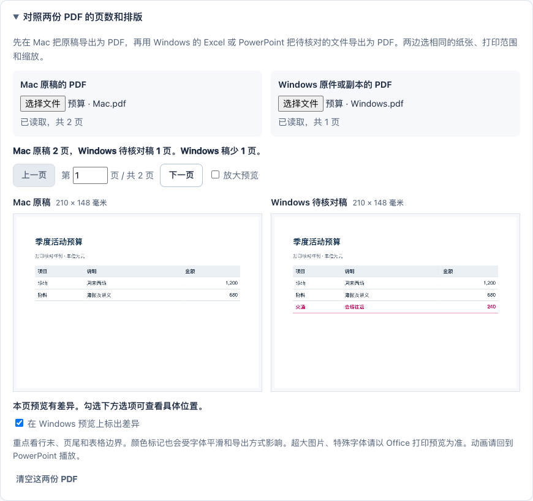

# OfficeBridge 中文使用指南

OfficeBridge 帮你在把 PPTX 演示文稿、XLSX 表格交给另一台电脑之前，检查兼容风险，并按你的选择生成可继续编辑的副本。当前自动修改主要是**字体名称替换**；它不安装字体，也不自动重排版面、修复公式或还原已经丢失的文字。

应用在浏览器本机处理文件。使用便携版本不需要安装 OfficeBridge、Node.js 或 Python，不需要登录，也可以断网使用。打开下载的 PPTX / XLSX 并检查编辑效果，才需要相应的文档软件。

你可以直接处理自己的文件；下面的合成样例用于熟悉操作。

## 1. 打开应用

[直接下载单文件应用](https://github.com/blqs886-lang/officebridge/releases/latest/download/OfficeBridge.html)。在电脑的“下载”文件夹中打开 `OfficeBridge.html`。拿到 `OfficeBridge-v1.0.0-portable.zip` 后，先解压整个压缩包，再打开里面的 `OfficeBridge.html`。不要在压缩包预览窗口里操作。

| 电脑 | 打开方法 |
| --- | --- |
| Mac | 在访达找到 `OfficeBridge.html`，右键选择“打开方式”，用 Google Chrome 打开。 |
| Windows | 在文件资源管理器找到解压后的 `OfficeBridge.html`，右键选择“打开方式”，用 Chrome 或 Edge 打开。 |
| Windows 虚拟机或共享文件夹 | 如果从 Mac 共享目录打开失败，把便携 ZIP 复制到 Windows 本地的“下载”或“文档”文件夹，解压后再打开。无需修改系统安全设置。 |

如果双击后看到的是代码或文本，通常是选错了打开应用：改用浏览器打开这个 HTML 文件。若浏览器显示下载页面而非工作台，先确认打开的是解压出来的文件。

离线工作台已在 **Mac Chrome** 和 **Windows 11 Edge** 中实际验证。另已在 Windows 桌面 Excel、PowerPoint 中对照过一组选定样本。自己的原件在 Windows 上显示、打印正常时，可以直接使用。需要修复时，对照 Mac 原稿检查具体变化。具体记录见 [测试范围](TESTING.md)。

`OfficeBridge-v1.0.0-source.zip` 是开发源码包，不能代替便携应用；普通使用请选择便携包或单个 HTML 文件。

## 2. 先用合成样例完成一次下载


建议先从“电子表格”开始。样例不包含你的资料。

1. 点 **“表格样例”**。文件检查完后，结果会显示「季度预算示例.xlsx」。
2. 先读结果上的建议。用自己的文件时，如果原件在接收电脑上显示正常，就可以直接用原件。示例可以放心试。
3. 在可替换的字体中，勾选一项。比如把苹方（PingFang SC）换成微软雅黑（Microsoft YaHei）。初次尝试也可点 **“只选较少影响排版的位置”**，检查勾选后再下载。它会跳过检测到的默认字体、受限文字等位置。所有替换都要额外核对时，会提示手动选择。同一字体在多处出现时，可以整组勾选，或展开 **“逐处选择”** 只改一个位置。
4. 点击 **“生成并下载副本”**，浏览器会下载 `季度预算示例.windows.xlsx`。如果浏览器询问存放位置，选自己容易找到的文件夹。完成后还可以再次下载这份副本。
5. 在浏览器的下载列表打开副本。在 Excel 中点击单元格，查看公式或修改数字。想保存检查记录时，展开 **“下载检查报告”**，点 **“下载可阅读的报告”**。

演示文稿的步骤相同。用 PowerPoint 打开 `跨系统交接示例.windows.pptx` 后，可以试着选中文字或播放幻灯片。

当前 1.0.0 合成样例的参考结果如下，已用当前引擎核对。规则或样例更新后数字可能变化，它们不是兼容性评分。

| 样例 | 内容数量 | 可选字体建议 | 全部采用后仍会出现的提醒 |
| --- | --- | --- | --- |
| 演示文稿 | 2 张幻灯片 | 3 项，涉及 `PingFang SC` 和 `Helvetica Neue`；同一字体可能出现在不同部件 | 2 项主题备用字体提醒 |
| 电子表格 | 2 个工作表：“预算示例”“编号与说明” | 2 项，涉及上述两种字体 | 4 项：主题备用字体、公式缓存、打印分页、文本编号保留 |

**修复后仍有提醒不等于失败。** 例如打印分页需要在目标软件里检查，工具不会为了减少提醒数量而删除相关内容。样例生成成功也不表示目标电脑已安装建议字体。

## 有打印或排版要求时，怎么确认

1. 在 **Mac** 打开看起来正确的原稿，用“文件”菜单导出或打印为 PDF。
2. 在 **Windows** 的桌面 PowerPoint 或 Excel 打开收到的原件，导出 PDF。要比较修复效果，再对下载的可编辑副本做一次。两边选相同的纸张、缩放、工作表或幻灯片范围。
3. 在 OfficeBridge 展开 **“对照两份 PDF 的页数和排版”**。把 Mac 的 PDF 放左边，Windows 的放右边。选好就能看到两份稿各有几页。
4. 点 **“下一页”**，或输入要核对的页码。页面大小相近时，可勾选 **“在 Windows 预览上标出差异”**，查看行末、页尾、列边界的变化。字太小时点 **“放大预览”**，上下查看两份稿。右边可以重新选择 Windows 副本的 PDF，左边的参照仍保留。
5. 对照后，用效果更符合原稿的 PPTX 或 XLSX 继续编辑。演示动画需在 PowerPoint 放映时复核。



每份 PDF 上限为 25 MiB。页数和纸张来自选中的 PDF，页面按页码对应。缩略预览中像素颜色变化也可能来自字体平滑；页面若提示“无法判断排版差异”，请在 PDF 阅读器中核对。字体未嵌入、非常大的图片或特殊图像也适合在原应用中查看。相同页数和当前分辨率下相似的预览都不能保证打印或编辑后的外观完全一致。

## 3. 放入你自己的文件

点击 **“选择文件”**，或把文件拖到首页的文件选择区。可以同时加入多个文件，工具会依次检查。

- 支持未加密的标准 `.pptx` 和 `.xlsx`。Keynote、Numbers、旧版 `.ppt` / `.xls` 请先在原软件中导出或另存为对应格式；只改扩展名不能转换格式。Word、PDF 和 Pages 文件不在当前支持范围内。
- 页面显示的限制为单个 100 MB、每批最多 20 个、合计 250 MB。计算采用 1 MB = 1,048,576 字节。包内内容也有安全处理上限，压缩后的文件较小不代表一定能处理。
- **加入有效文件后，页面会自动切换到本次新增的第一个文件，并显示该文件的检查结果。** 核对结果标题中的文件名；在“本次文件”点击其他文件可以切换查看。之前文件的选择和已生成副本会保留。
- 多个文件各自选择、生成和下载，不会因为给一个文件勾选建议，就自动修改其他文件。

“需处理”“需复核”“提示”是发现的类别。想看完整结果，展开 **“查看全部检查结果”**，再点击 **“全部”**；没有发现某类问题，或当前规则没有提示，都不等于已经通过 Windows Office 验证。

原稿用 Keynote 或 Numbers 制作时，可从原应用的导出菜单选择 PowerPoint 或 Excel，将副本存到本机。[Apple 的格式转换说明](https://support.apple.com/zh-cn/105050)

先阅读字体建议，再勾选并生成。工具不回写原文件，下载副本默认带 `.windows.pptx` 或 `.windows.xlsx` 后缀；如浏览器询问保存名称，请保留一个与原件不同的名称。

### 文件里已经出现乱码时

在工作台展开“查看全部检查结果”，找到对应的问题，点“查看检查依据”。也可以在 HTML 报告中查找“证据”。例如，文稿中存成 `中文` 的一段文字，可能来自把 UTF-8 当作西文编码读取。工具会给出短预览“中文”，可以和原始资料核对。请在原应用中确认后更正，或从正确编码的源文件重新导入。如果文档里存的是替换字符 `�`，原字通常需要从其他副本找回。图标显示成方框则要核对原来的图标字体。

## 4. 字体建议不合适时

没有目标名单也可以检查文件。有接收方的 Windows 电脑时，可以按这台电脑的字体筛选建议。

1. 在目标 Windows 的 Edge 或 Chrome 打开同一份 `OfficeBridge.html`，点“表格样例”。展开 **“更多字体设置”**。
2. 点 **“读取这台 Windows 的字体”**。浏览器询问权限时，由电脑使用者决定是否允许。成功后页面会显示读到的名称数量，名单已应用到当前文件。
3. 要回 Mac 做检查，点 **“保存名单到 TXT”**，把得到的 `OfficeBridge-Windows-fonts.txt` 带回 Mac。在需要检查的文件下展开“更多字体设置”，点 **“导入字体名单 (.txt)”**。
4. 展开 **“查看文档字体对照”**。内置建议会保留已列入的原字体，仅建议使用名单里有的目标名称。自己添加的规则可以替换已列入的原字体。新设置生效会清除当前文件的旧选择和待下载副本。
5. “移除名单并重新检查”可恢复常规建议。名单仅用于当前文件。导出的 HTML 和 JSON 报告只列出文档字体的对照及名称总数，完整名单可通过“保存名单到 TXT”单独导出。

如果浏览器未提供读取按钮或你选择拒绝权限，可用记事本每行写一个已确认的字体家族名称，以 UTF-8 保存。也可以在接收方的 **Windows PowerShell** 粘贴下面的命令，在桌面生成带时间戳的名单，然后用“导入字体名单”打开。

```powershell
Add-Type -AssemblyName System.Drawing
$fontListPath = Join-Path ([Environment]::GetFolderPath('Desktop')) ("OfficeBridge-fonts-{0:yyyyMMdd-HHmmssfff}.txt" -f (Get-Date))
(New-Object System.Drawing.Text.InstalledFontCollection).Families | ForEach-Object { $_.Name; $_.GetName(1033) } | Sort-Object -Unique | Set-Content -Encoding UTF8 -LiteralPath $fontListPath
```

名称未列入时，可再核对本地化名称、Office 云字体或嵌入字体。即使名称相同，也需要核对字重、字符覆盖和换行。浏览器只在用户主动点击并允许后读取字体家族名称。[Chromium 本机字体接口](https://developer.chrome.com/docs/capabilities/web-apis/local-fonts) · [Windows 系统字体枚举](https://learn.microsoft.com/en-us/dotnet/api/system.drawing.text.installedfontcollection)

如果你已知道合适的目标字体：

1. 在该文件结果中展开 **“更多字体设置”**。
2. 在“原字体”选择文档里的字体，在“目标字体”填写接收方确认可用的字体名称，例如 `Microsoft YaHei`。
3. 点击 **“添加规则并重新检查”**。
4. 重新检查完成后，再勾选新建议，点击 **“生成并下载副本”**，在浏览器下载列表中找到文件。

自定义规则只影响当前文件。添加、更新或移除规则会清空旧选择和工作台中的旧副本，需要重新确认；已经下载到磁盘的副本不会因此改变。**“移除并重新检查”**可以撤销该条自定义规则。

符号、数学、图标和 emoji 字体不适合按普通字体替换，工具会拒绝相关规则。显示“规则未应用”时，保留的是上次有效检查结果；按提示调整规则，或在原始文档软件里处理。

## 5. 保存报告，带着记录交接

展开 **“下载检查报告”** 可保存 HTML 或 JSON。生成副本后再导出，报告也会列出实际采用的修改；成功提示框中还可展开“查看修改记录和复查结果”。

| 按钮 | 得到什么 |
| --- | --- |
| **下载可阅读的报告** | 独立浏览器页面，包含发现、位置、检查参数、自定义字体规则，以及已生成副本的修改记录。可用浏览器打印功能另存 PDF。 |
| **下载 JSON** | 同类检查数据，便于开发者或其他工具读取。普通查看用 HTML 即可。 |
| **查看修改记录和复查结果** | 在当前页面查看哪些字体在什么部件被替换，以及替换次数。 |

没有选择替换时也可以下载检查报告。没有可自动修复项的文件，不需要为了拿到副本而强行添加规则；保留原件并按报告人工核对即可。

报告可能包含文件名、内部路径、外部链接或其他检查证据，分享前应查看内容。工具在本机处理并不意味着你主动发出的报告不会包含文档信息。

**关闭、刷新或点击“清空列表”会清除工作台内容。** 原件与已经下载的文件不受影响，但未下载的副本和本次选择不会自动恢复。先下载所需文件和报告，再清空或关闭。

## 6. 怎样确认副本仍能编辑

OfficeBridge 保留原有文本、公式和对象结构。最终是否能正常编辑、计算和播放，要用接收方实际使用的软件打开下载副本确认。不要只看浏览器预览图或文件缩略图。

### 演示文稿

1. 用目标 PowerPoint 或 WPS 演示打开下载的 `.windows.pptx`，确认没有文件损坏或修复提示。
2. 点击一段正文或标题，确认能进入文字编辑状态、放置光标并修改文字；仅能选中整页图片，不能证明文字可编辑。原稿本来就是图片的区域也不会被工具转换成文字。
3. 选择原稿中的图表，检查软件是否仍把它识别为图表，并能进入其编辑数据功能。不能只凭图表外观判断。
4. 逐页查看换行、文本溢出、图片位置、图表、备注和打印版式；实际播放需要使用的动画、音视频和链接。
5. 将测试修改另存为一个新的测试文件，关闭后重新打开，确认编辑内容保留。保留最初下载的副本，便于比较。

### 电子表格

1. 用目标 Excel 或 WPS 表格打开下载的 `.windows.xlsx`，检查工作表、文本、数字和打印预览。如果修复建议标出了工作簿默认字体，或用于自动换行、自动行高的文字，原件打印正常时可以保留原字体。采用建议后，请在同一台 Excel 上用相同纸张和缩放打开两份打印预览，比较总页数和每页首末行。
2. 点击公式单元格，在编辑栏中确认仍是公式；能看到一个数字结果不等于公式还在。
3. 在合成样例的“预算示例”工作表中，C5 应包含 `=SUM(C2:C4)`。正常重算后的结果为 **4750**；把 C3 从 **2900** 暂时改成 **3000**，C5 应变成 **4850**。若软件处于手动计算模式，先用它的计算功能重算。
4. 在“编号与说明”工作表检查 A2 仍为 `00123`，A3 仍为 `12345678901234567890`，没有丢失前导零或变成近似数值。
5. 撤销样例修改，或另存一份测试文件后关闭并重新打开。自己的文件还要核对重要公式、日期、外部数据、筛选、图表和打印分页。

上述样例的 Mac Excel 编辑与重算已实际检查；这不是 Windows Excel 的验证结论。工具不会计算工作簿，也不会替你刷新外部数据。

需要固定外观的交接，可以另外附一份从原稿导出的 PDF；PPTX / XLSX 副本仍用于编辑。完整验证边界见 [测试范围](TESTING.md)。可选的 [Windows 验证脚本](WINDOWS-VERIFICATION.md) 需要已安装的 Windows 桌面 Office，不是开始使用本工具的必需步骤。

## 7. 遇到问题时

| 现象 | 处理方法 |
| --- | --- |
| “生成并下载副本”是灰色 | 先勾选至少一个字体建议。若没有可修复项，正常导出报告即可；显示“这个文件只能检查”时，生成按钮会隐藏，请按结果提示在原软件处理。 |
| 加入了文件，却仍看到样例或上个文件 | 先看页面错误提示：不支持格式、空文件或超限文件不会加入列表，也不会改变当前选择。有效文件加入后会自动切换；批量查看其他文件时，在“本次文件”点击文件名。 |
| 显示“可编辑副本已生成”，找不到文件 | 查看浏览器下载记录及保存位置。第一次下载若被阻止或取消，可以点“再次下载副本”。 |
| 副本已经下载，但“再次下载副本”按钮消失 | 改变勾选或字体规则会使旧结果失效，需要重新生成。磁盘上之前下载的文件仍在。 |
| 提示空文件、不支持格式、加密或文件损坏 | 回原始软件确认能正常打开，解除文档加密或导出标准 PPTX / XLSX 后再加入。不要只改文件后缀。 |
| 签名、宏、Strict 或危险结构被禁止修复 | 当前版本有意限制这些文件。保留原件，在原始软件中处理，或按需要导出普通标准副本后重新检查。 |
| 超过文件大小、批次数量或内部处理上限 | 先下载已有成果，再点击“清空列表”。大文档可在原软件中拆分，或删除不需要的内容后另存新文件；不要把唯一原件当作测试文件。 |
| 提示“文件处理超过 60 秒” | 本次处理已停止，原件未改动，后续队列可继续。尝试在原软件中拆分或重新导出，不必一直等待同一条任务。 |
| 提示“本机检查程序遇到错误”或“不可用” | 先保存已有成果，重新添加文件；仍失败时刷新页面，再用内置样例排查。样例也失败时，用本地文件夹中的完整便携版本在 Chrome 打开。 |
| 更换字体后仍乱码、换行不同或文字溢出 | 确认目标字体已经安装且支持这些字符。比较原稿；已损坏或丢失的文字需要从原始内容恢复。工具不会自动修复编码、字距或文本框大小。 |
| 刷新后文件列表为空 | 工作台不自动保存会话。重新加入原文件；已下载副本和报告仍在浏览器保存的位置。 |

反馈问题时，优先提供：应用版本、操作系统、浏览器、文件格式、报错原文和能复现的非敏感合成文件。不要为了排查而公开真实业务文档或未检查的报告。
